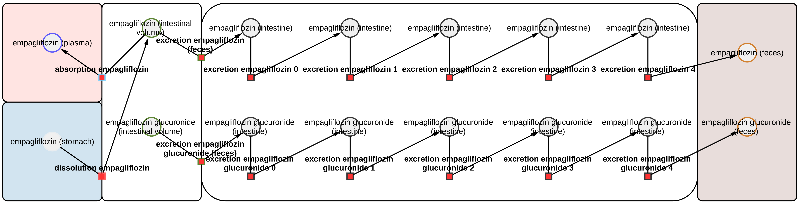
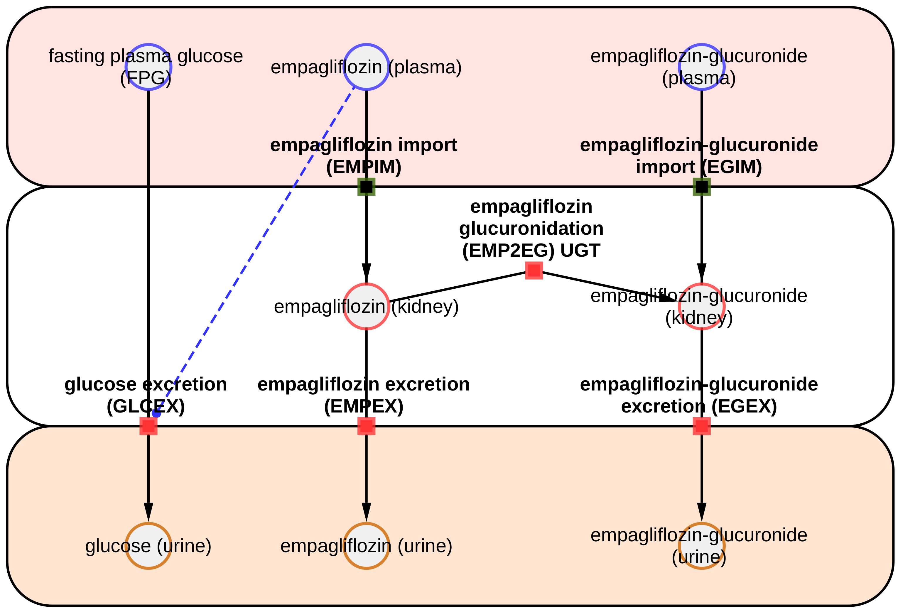
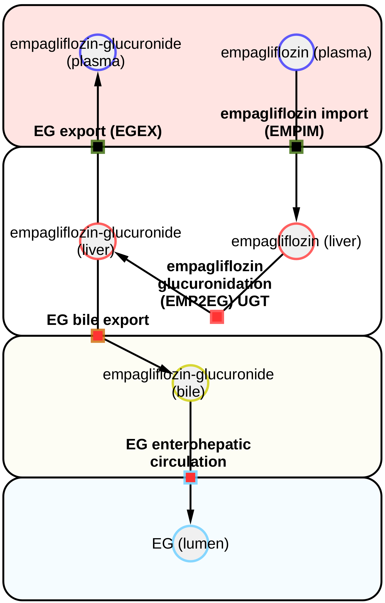

# Models

The models are distributed in [SBML](http://sbml.org) format.

## empagliflozin_body

* Model: [`empagliflozin_body.xml`](https://raw.githubusercontent.com/matthiaskoenig/empagliflozin-model/main/models/empagliflozin_body.xml)
* Equations: [`empagliflozin_body.md`](https://github.com/matthiaskoenig/empagliflozin-model/blob/main/models/empagliflozin_body.md)
* Report: [SBML4humans](https://sbml4humans.de/report?url=https%3A%2F%2Fraw.githubusercontent.com%2Fmatthiaskoenig%2Fempagliflozin-model%2Fmain%2Fmodels%2Fempagliflozin_body.xml)

## empagliflozin_body_flat

* Model: [`empagliflozin_body_flat.xml`](https://raw.githubusercontent.com/matthiaskoenig/empagliflozin-model/main/models/empagliflozin_body_flat.xml)
* Equations: [`empagliflozin_body_flat.md`](https://github.com/matthiaskoenig/empagliflozin-model/blob/main/models/empagliflozin_body_flat.md)
* Report: [SBML4humans](https://sbml4humans.de/report?url=https%3A%2F%2Fraw.githubusercontent.com%2Fmatthiaskoenig%2Fempagliflozin-model%2Fmain%2Fmodels%2Fempagliflozin_body_flat.xml)

## empagliflozin_intestine

* Model: [`empagliflozin_intestine.xml`](https://raw.githubusercontent.com/matthiaskoenig/empagliflozin-model/main/models/empagliflozin_intestine.xml)
* Equations: [`empagliflozin_intestine.md`](https://github.com/matthiaskoenig/empagliflozin-model/blob/main/models/empagliflozin_intestine.md)
* Report: [SBML4humans](https://sbml4humans.de/report?url=https%3A%2F%2Fraw.githubusercontent.com%2Fmatthiaskoenig%2Fempagliflozin-model%2Fmain%2Fmodels%2Fempagliflozin_intestine.xml)

{ style="max-height: 420px; width: auto; max-width: 100%" }

## empagliflozin_kidney

* Model: [`empagliflozin_kidney.xml`](https://raw.githubusercontent.com/matthiaskoenig/empagliflozin-model/main/models/empagliflozin_kidney.xml)
* Equations: [`empagliflozin_kidney.md`](https://github.com/matthiaskoenig/empagliflozin-model/blob/main/models/empagliflozin_kidney.md)
* Report: [SBML4humans](https://sbml4humans.de/report?url=https%3A%2F%2Fraw.githubusercontent.com%2Fmatthiaskoenig%2Fempagliflozin-model%2Fmain%2Fmodels%2Fempagliflozin_kidney.xml)

{ style="max-height: 420px; width: auto; max-width: 100%" }

## empagliflozin_liver

* Model: [`empagliflozin_liver.xml`](https://raw.githubusercontent.com/matthiaskoenig/empagliflozin-model/main/models/empagliflozin_liver.xml)
* Equations: [`empagliflozin_liver.md`](https://github.com/matthiaskoenig/empagliflozin-model/blob/main/models/empagliflozin_liver.md)
* Report: [SBML4humans](https://sbml4humans.de/report?url=https%3A%2F%2Fraw.githubusercontent.com%2Fmatthiaskoenig%2Fempagliflozin-model%2Fmain%2Fmodels%2Fempagliflozin_liver.xml)

{ style="max-height: 420px; width: auto; max-width: 100%" }

## COMBINE archive

The models and the metadata are available as COMBINE archive from [`empagliflozin_model.omex`](https://raw.githubusercontent.com/matthiaskoenig/empagliflozin-model/main/empagliflozin_model.omex).
